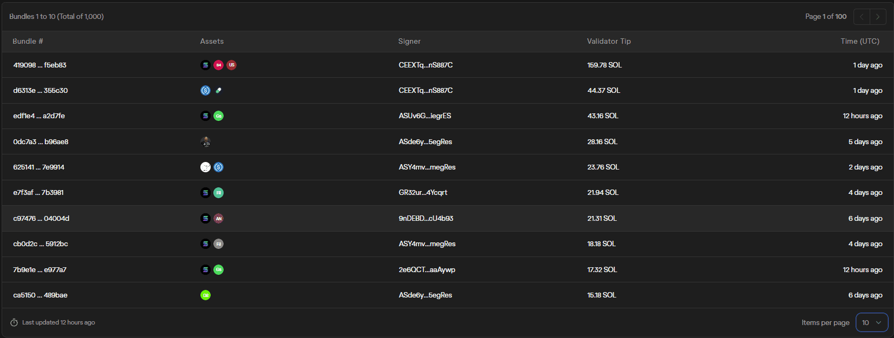
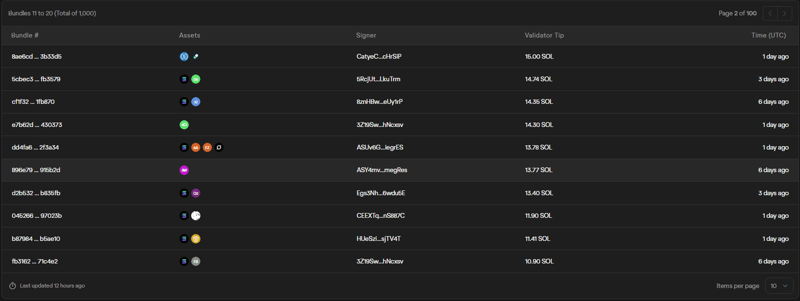
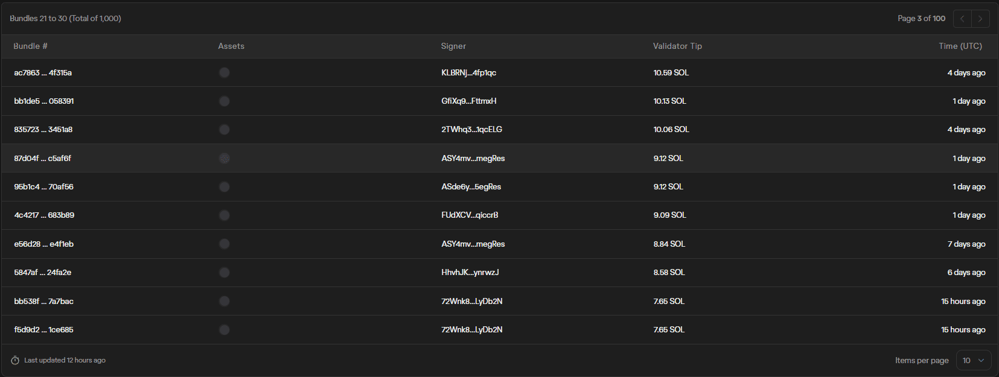
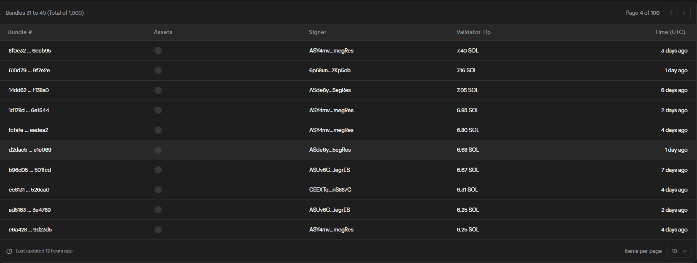
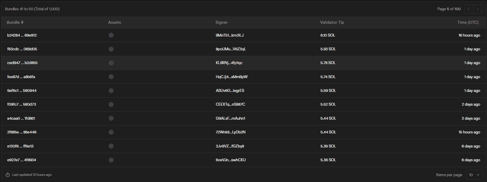
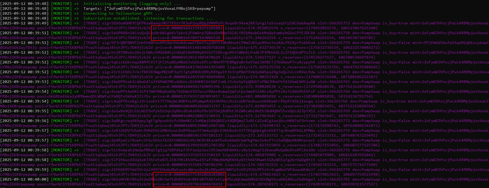

# 1. About the Jito Tip

## what is jito tip

Jito tip is an additional fee(tip) included with transactions or bundles of transactions sent to Jito validator clients on the Solana network.

These tips incentivize Jito validators to give priority to transactions, processing them faster and in a guaranteed order ahead of others.

## The reason is needed in arbitrage

Jito tip is needed on Solana primarily because it helps prioritize and speed up transaction processing in a competitive, high-speed blokchain environment.

Essential for latency-sensitive tasks like arbitrage, liquidations and complex Defi flows.

### main workflow of jito tip
- Solana validators produce blocks containing many user transactions.
- Validators have incentives(rewards) to include transactions that pay higher fee first
- By attaching a tip, users can run fast trnasactions than others.
- Without a tip, transactions may be delayed or fail during congestion.

## Why Jito tips are still needed despite fast infra:

### Transaction Ordering and Prioritization:
- Solana validators prioritize transactions that pay higher fees, including Jito tips, for inclusion in blocks.
- Fast infrastructure helps you send transactions quickly but does not guarantee priority in block production order.
- Validators pick transactions based on economic incentives (tips + fees).

### Network Congestion and Competition:
- During peak demand, many users compete to get their transactions confirmed first.
- Even with fastest RPC nodes like Helius, if you do not pay tips, your transaction can get delayed or dropped because validators prefer transactions with higher tips.

## Conclusion : Jito tip is needed for our project - arbitrage bot

# 2. Jito Tip range in Solana especially in time sensitive transactions like arbitrage.

## Jito tip range 

You can check [here](https://explorer.jito.wtf/bundle-explorer?sortBy=Tip "Jito Tip Explorer")

## Price differences in several dexs

sol_usd = $200(now $230)

Price_difference = 0.0000009090695569180615 - 0.0000009057231624805397 = 0.000000003346394437521828
USD = $0.0000006692788875043656

jito tip = $10
profit = $10
toten_amount = 29882908.86416097
initial_money = 27.065642720565627

jito tip = $20
profit = $10
toten_amount = 44824363.296241455
initial_money = 40.59846408084844